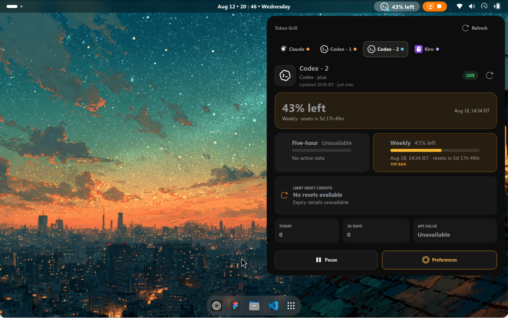
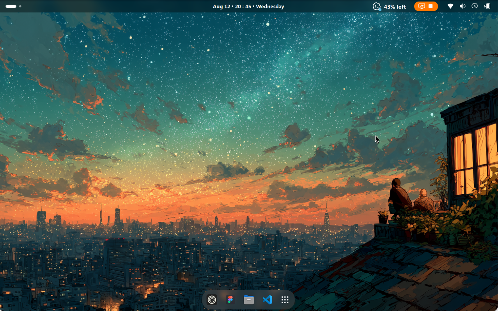

# Token Grill

Token Grill shows the usage limits of your AI accounts in the GNOME top bar.

Token Grill monitors more than one account at the same time. From the top bar,
you can see the remaining usage of each account and the reset times.

Token Grill has two parts: the GNOME Shell extension, which shows the results,
and a small free service, `tokengrill`, which reads your sign-ins and gets the
usage limits. You install both. Refer to [Install](#install).



## Functions

These are the functions of the top bar and the popup:

- Token Grill monitors Codex, Claude, Kiro, Antigravity, GitHub Copilot,
  OpenCode Go, Kimi Code, and Cursor accounts, and the DeepSeek balance. You can add
  more than one account for each service.
- The top bar shows one entry for each service. Each entry shows the limits
  that you checked for each account, as text, as rings, or as bars. In
  Preferences, **Position** puts Token Grill on the left or the right side of
  the top bar.
- The popup shows the limits of each account and their reset times in your
  local time zone. To show a limit in the top bar, check it in the popup.
- If a refresh gets an error, the popup keeps the last good values and shows
  the error. The last values stay after a lock, a restart, or an update,
  with the time of the reading, until a refresh works.
- If a sign-in is missing or expired, **Sign In Again in a Terminal** opens
  your terminal with the login command of that account, for example
  `codex login` with `CODEX_HOME` set to the home of the account. Token Grill
  does not exchange Codex or Claude refresh tokens itself. For an expired
  Claude Code access token, the service asks the installed Claude CLI to renew
  its own credentials with `claude auth status` and then rereads them.
- **Usage Pace** in the account preferences shows whether a limit is used
  faster or slower than its period passes. The popup shows one line for each
  limit, and the top bar shows an icon: a flame for a fast pace, a check mark
  for an even pace, and a snowflake for a slow pace. The length of each period
  comes from the service: Codex and Cursor report it, Claude, Antigravity,
  Kimi Code, and OpenCode Go name their five-hour and weekly windows, and the
  monthly allowances of Copilot, Kiro, Kimi Code, and OpenCode Go run from one
  reset date to the same date the month before. A limit
  whose length is not known shows no pace.

These are the other functions:

- Token Grill can send a notification when the usage of a limit becomes more
  than a usage step. Only the limits that the top bar shows send notifications.
  The notification shows the service, the account, the limit, the percentage,
  and the reset time.
- For Codex and Claude accounts, Token Grill can read the local session
  history. It keeps only token totals. It does not keep prompts or responses.
- For Codex accounts, the popup shows the number of available reset credits.
  Token Grill does not use a reset credit.



## Install

Token Grill operates with **GNOME Shell 48, 49, 50, and 51**. It needs
Python 3.11 or later for the service.

Do these two steps. The commands below are the same ones that the popup and the
preferences show when the service is missing.

1. Install the extension.

    After GNOME Shell Extensions approves the first release, search for
    **Token Grill** in [Extension Manager](https://mattjakeman.com/apps/extension-manager)
    or on [GNOME Shell Extensions](https://extensions.gnome.org/). This method
    also gives you the updates.

    To install a release archive before the approval, run this command, log
    out and log in again, and enable Token Grill in Extension Manager or in the
    Extensions app:

    ```sh
    gnome-extensions install --force tokengrill@sh02sahil.github.io.shell-extension.zip
    ```

2. Install the service and register it:

    ```sh
    pipx install tokengrill && ~/.local/bin/tokengrill setup
    ```

    If you do not have pipx, install it first: `sudo apt install pipx` on
    Ubuntu or Debian, `sudo dnf install pipx` on Fedora. With uv, use
    `uv tool install tokengrill && ~/.local/bin/tokengrill setup`.

The popup and the preferences show a **Copy** button next to each of these
commands. The button writes the fixed command to the clipboard after your
click. Token Grill never reads the clipboard.

To update the service, run `pipx upgrade tokengrill`. To see the accounts and
limits in a terminal, run `tokengrill status`. Add `--refresh` to refresh all
accounts first, or `--json` for the raw state.

To remove the service registration, run `tokengrill uninstall`. Add `--purge`
to be asked if the accounts, the history, and the pasted API keys are also
deleted. Before it deletes them, it stops the running service, so that the
service does not write the files again. The keyring can ask to be unlocked.
Then run `pipx uninstall tokengrill`.

### Try a release without logging out

[`tools/try.sh`](tools/try.sh) opens a release archive in a nested GNOME Shell
window. The nested shell has its own settings, extensions and keyring. Your
session does not change. The script needs the Mutter devkit. On Debian or
Ubuntu, the package is `mutter-dev-bin`.

```sh
bash try.sh tokengrill@sh02sahil.github.io.shell-extension.zip
```

The nested shell reads the sign-ins of your apps, but not the keys in your
keyring. To try an API key, paste it again in the nested shell. The first key
asks for a password for a new test keyring. When you close the window, the
script deletes the test settings and the test keyring. The script also needs
the service: install it as above and run `tokengrill setup` first. The nested
shell starts its own copy of the service, with the test settings.

## Add an account

1. Sign in to the service with the app of that service. Token Grill does not
   sign in for you.
2. Open the preferences of Token Grill.
3. Go to the **Accounts** page.
4. Select **Add Account...**, and then select the app that you sign in with.
   Token Grill shows the signed-in accounts of that app.
5. Check the accounts to add, and then select **Add**.

If the account is in a folder that Token Grill did not find, or is not signed
in yet, type or choose its home folder under **Another Home Folder**. For
example, `~/.codex-work` adds a Codex account there. If it is not signed in,
the popup shows **Sign In Again in a Terminal**.

To find the accounts of all the supported apps, select **Discover...**. Token
Grill adds the accounts that you check and shows them in the top bar.

These are the apps that Token Grill reads:

| Service        | Apps                                                     |
| -------------- | -------------------------------------------------------- |
| Codex          | Codex CLI, OpenCode                                      |
| Claude         | Claude Code, OpenCode                                    |
| Kiro           | Kiro CLI                                                 |
| Antigravity    | Antigravity, Antigravity CLI                             |
| GitHub Copilot | GitHub CLI, Copilot CLI, OpenCode                        |
| OpenCode Go    | OpenCode                                                 |
| DeepSeek       | OpenCode, Claude Code settings, or a key that you paste  |
| Kimi Code      | Kimi CLI, OpenCode                                       |
| Cursor         | Cursor, Cursor CLI                                       |

Each home directory is a different account. For example, `~/.codex` and
`~/.codex2` are two Codex accounts. Token Grill does not read the Copilot
sign-in of VS Code, because VS Code encrypts it.

To select a name, a color, or the local history of an account, select the
account on the **Accounts** page.

## The service

The service is the Python package `tokengrill`. The session bus starts it
(D-Bus activation) when the extension calls it, and the service exits 60 seconds after the last
Token Grill window or preferences window has left. It does these tasks:

- It reads the sign-ins of the apps that you use, and the API keys that you
  save in the keyring.
- It gets the usage limits from each service, and keeps the readings, the
  history totals, and the accounts.
- It decides when a notification is due. It runs its scheduler, its history
  scans, and its notifications only while the extension is connected.
- It serves all this to the extension over D-Bus. It never returns a token,
  a key, or the content of a file on D-Bus.

The service needs no system library except a working D-Bus session. It has
three Python dependencies: `dbus-fast`, `httpx`, and `secretstorage`. The
details are in [service/README.md](service/README.md).

### Privacy and network access

The service reads the credentials that the CLI of each service stored on this
computer. Its HTTP client sends these credentials only to that service and
connects only to these hosts. The extension itself makes no network request:

| Service     | Host                                                                                                                                               | Purpose                                 |
| ----------- | -------------------------------------------------------------------------------------------------------------------------------------------------- | --------------------------------------- |
| Codex       | `chatgpt.com`                                                                                                                                      | Usage limits and reset credits          |
| Claude      | `api.anthropic.com`                                                                                                                                | Usage limits                            |
| Kiro        | `codewhisperer.us-east-1.amazonaws.com` or `q.eu-central-1.amazonaws.com`                                                                          | Usage limits                            |
| Kiro        | `q.us-gov-east-1.amazonaws.com` or `q.us-gov-west-1.amazonaws.com` (AWS GovCloud)                                                                  | Usage limits                            |
| Kiro        | `q.us-iso-east-1.c2s.ic.gov`, `q.us-isob-east-1.sc2s.sgov.gov`, `q.us-isof-south-1.csp.hci.ic.gov`, or `q.us-isof-east-1.csp.hci.ic.gov` (AWS ISO) | Usage limits                            |
| Kiro        | `oidc.<region>.amazonaws.com`                                                                                                                      | A new token when the sign-in is expired |
| Antigravity | `cloudcode-pa.googleapis.com`                                                                                                                      | Plan and usage limits                   |
| Antigravity | `oauth2.googleapis.com`                                                                                                                            | A new token when the sign-in is expired |
| Copilot     | `api.github.com`                                                                                                                                   | Monthly allowances                      |
| OpenCode Go | `opencode.ai`                                                                                                                                      | Usage limits                            |
| DeepSeek    | `api.deepseek.com`                                                                                                                                 | Prepaid balance                         |
| Kimi Code   | `api.kimi.com`, or `api.kimi.ai` when Kimi Code is set to that region                                                                              | Usage limits                            |
| Cursor      | `api2.cursor.sh`                                                                                                                                   | Plan and usage limits                   |

Each request obeys these limits:

- The request goes only to a host on a fixed list.
- The request uses only HTTPS.
- The service does not accept redirects.
- The service rejects a response larger than 1 MiB.
- The request stops after 30 seconds.

Each request uses this User-Agent:

```text
TokenGrill (+https://github.com/sh02sahil/token-grill; usage monitor for Codex, Claude, Kiro, Antigravity, Copilot, OpenCode Go, DeepSeek, Kimi Code and Cursor)
```

The Antigravity quota service gives data only when the User-Agent contains
the word Antigravity. Thus, the User-Agent names all the services that Token Grill
monitors.

For expired Claude Code credentials with a refresh token, the service runs
`claude auth status`, without a shell or terminal, with `CLAUDE_CONFIG_DIR`
set to the folder of the credentials file. Claude Code owns its refresh
requests, locking, and credential writes; these requests use the CLI's network
configuration, not Token Grill's HTTP client. Token Grill disables CLI
auto-updates and nonessential traffic for this command and discards its output.
The command has a 30-second limit and is stopped if collection is cancelled.
Failed attempts are limited to one per file every five minutes. The CLI must
be on PATH or installed at `~/.local/bin/claude`. This was checked with Claude
Code 2.1.285. A successful exit alone does not count as a renewed sign-in:
Token Grill rereads the file and checks its expiry.

This applies only to Claude Code files named `.credentials.json`, including
an override with that name. OpenCode credentials and other filenames still
need renewal by their owning app. Credential checks in Preferences stay
read-only. A revoked refresh token still needs an interactive sign-in.

When you click **Sign In Again in a Terminal**, the extension opens your
terminal with the login command of that account's CLI, from a fixed list in
the extension. Token Grill does not collect telemetry or read or send prompts
or responses.

The Kiro usage request gets the e-mail address of the account. The popup shows
this address. Thus, you can see which account `kiro-cli` uses. Token Grill does not
write the address to a file.

### Local files that Token Grill reads

Each account has a home directory. For each account, you can set a different
credential file and a different sessions directory.

For Codex and Claude accounts, Token Grill reads these files:

- Codex: `<home>/auth.json`. The default home is `~/.codex`. With local
  history, Token Grill also reads `<home>/sessions/` and
  `<home>/archived_sessions/`.
- Claude: `<home>/.credentials.json`. The default home is `~/.claude`. With
  local history, Token Grill also reads `<home>/projects/`.

For Kiro and Antigravity accounts, Token Grill reads these files:

- Kiro: `<home>/data.sqlite3`. The default home is `$XDG_DATA_HOME/kiro-cli`.
  Token Grill opens the database read-only, with the SQLite `query_only` guard.
  It reads the database again only after its size or modification time
  changes.
- Antigravity: the first of `acp_token.json`, `oauth_creds.json`, and
  `credentials.json` in the home. The default home is
  `~/.gemini/antigravity-cli`. **Discover...** also finds `~/.gemini/antigravity`,
  `~/.antigravity`, and `~/.config/Antigravity`.

If Token Grill cannot use an Antigravity credential file, it reads the Secret
Service item of the Antigravity CLI (`service=gemini`, `username=antigravity`).
Token Grill does not unlock a locked keyring.

For the new services, Token Grill reads these files and keyring items:

- OpenCode: `$XDG_DATA_HOME/opencode/auth.json`. Token Grill does not refresh
  an OpenCode sign-in. If the sign-in is expired, open OpenCode and sign in
  again.
- GitHub CLI: `~/.config/gh/hosts.yml`, and the keyring item of the GitHub CLI
  (`service=gh:github.com`).
- Copilot CLI: the keyring item of the Copilot CLI (`service=copilot-cli`).
- Kimi CLI: `~/.kimi-code/credentials/kimi-code.json` and
  `~/.kimi-code/config.toml`.
- Cursor: `<home>/User/globalStorage/state.vscdb`, the `cursorAuth/accessToken`
  and `cursorAuth/cachedEmail` rows. The default home is
  `$XDG_CONFIG_HOME/Cursor`. Token Grill opens the database read-only, as for
  Kiro. When Cursor is closed, Token Grill reads a private copy in
  `$XDG_RUNTIME_DIR/token-grill/` and removes it at once, because SQLite would
  otherwise create files beside the database. Cursor renews its own sign-in;
  Token Grill does not. The popup shows the e-mail address of the account.
  Newer Cursor versions can encrypt this sign-in with a key from the system
  keyring. Token Grill does not decrypt the sign-ins of other apps, so it then
  shows that the sign-in is encrypted. Use the Cursor CLI sign-in instead.
- Cursor CLI: `~/.config/cursor/auth.json`, the `accessToken` that
  `agent login` stores. The CLI renews its own sign-in; Token Grill does not.
- DeepSeek: the `env` of Claude Code `settings.json`, when Claude Code uses
  DeepSeek. A key that you paste is in the GNOME keyring, in an item of Token
  Grill (`org.gnome.shell.extensions.tokengrill.ApiKey`). When you remove the
  account, Token Grill removes the item.

If a Kiro or Antigravity access token is expired, Token Grill gets a new token.
It keeps the new token only in memory. It does not write the token to the files
or the keyring of the service.

### Files of Token Grill

- `$XDG_CONFIG_HOME/token-grill/config.json` contains the accounts and the
  settings (mode 0600). The first time that the service starts, it imports the
  accounts of version 0.4 from the GNOME settings and keeps a backup in
  `imported-0.4.json` in the same folder.
- `$XDG_DATA_HOME/token-grill/` contains the usage totals.
- `$XDG_DATA_HOME/dbus-1/services/io.github.sh02sahil.TokenGrill.service` is
  the D-Bus service file that `tokengrill setup` writes.
- `$XDG_STATE_HOME/token-grill/` contains the history checkpoints, the
  notification state, the full DeepSeek balance after each top-up, the
  diagnostics, and the last reading of each account (`readings-v1.json`: the
  plan, the limits, and their reset times, without the e-mail address).

The diagnostics contain the latest 200 refresh steps: the host and path of each
request, the field names and types of each response, and the error codes.
Token Grill removes tokens, keys, e-mail addresses, and your home folder before
it writes a step.

These files do not contain credentials, service responses, prompts, or
responses.

### Diagnostics for testers

To save a report for a bug report, open the **Data** page in the preferences
and select **Save Diagnostics Report...**. The report does not contain tokens,
keys, e-mail addresses, account names, or your home folder.

The service writes its messages to the journal. To see them, run this command:

```sh
journalctl --user -t io.github.sh02sahil.TokenGrill -t tokengrill
```

To also see each refresh step there, set the `journalDiagnostics` setting of
the service:

```sh
busctl --user call io.github.sh02sahil.TokenGrill /io/github/sh02sahil/TokenGrill \
    io.github.sh02sahil.TokenGrill1 SetSettings s '{"journalDiagnostics":true}'
```

To stop the refresh steps, set the setting to `false`.

## Test a development build

Use a nested GNOME Shell with a separate data directory and a separate state
directory. Do these steps:

1. Run these commands:

    ```sh
    export XDG_DATA_HOME="$(mktemp -d)" XDG_STATE_HOME="$(mktemp -d)"
    npm ci
    npm run install:local
    npm run dev:shell
    ```

    `npm run dev:shell` starts `dbus-run-session -- gnome-shell --devkit --wayland`.
    The script enables Token Grill, disables it, and enables it again. After
    each step, it shows the state of the extension.

2. In a different terminal, look at the log:

    ```sh
    journalctl -f -o cat /usr/bin/gnome-shell
    ```

3. Lock and unlock the nested session one time. The script shows the commands.

CAUTION: The nested shell uses the same dconf database as your desktop. If you
change a preference in the nested shell, the preference also changes on your
desktop.
If you enable or disable an extension in the nested shell, the extension also
changes on your desktop.

To try the build with separate settings and a separate keyring, run
`npm run pack && npm run try`.

For the full procedure, refer to [CONTRIBUTING.md](CONTRIBUTING.md).

## Why this exists

Token Grill started as a personal tool. I wanted one GNOME extension with these
functions:

- More than one account for each service.
- The services that I use when I write code.
- Small displays in the top bar.
- Clear reset times.
- Local history that keeps prompts and responses private.

I did not find an extension with all these functions. Thus, I made this
extension, and I share it.

The first release monitored Codex, Claude, Kiro, and Antigravity, because I use
these services. Version 0.4.0 adds GitHub Copilot, OpenCode Go, DeepSeek,
Kimi Code, and Cursor. Token Grill can monitor more services in the future, if they
do not decrease the privacy or the reliability of the extension.

## AI development declaration

AI played a substantial role in Token Grill's development. The project was
created for personal use with **OpenAI GPT-5.6 Sol** for beginning, **Claude Opus 5.5** from then on. **T3 Code** served as the agentic coding environment and
orchestration interface.

AI assistance covered design exploration, implementation, refactoring, tests,
security review, and documentation. I directed that work, tested the resulting
extension, reviewed what is published, and remain responsible for maintaining
and explaining the code.

## Troubleshooting

- **Sign-in required:** Click **Sign In Again in a Terminal** in the popup, or
  open the CLI of the service and sign in again. If no terminal opens, install
  a terminal that GLib can start, such as GNOME Console or GNOME Terminal.
- **The popup asks you to install the service:** Run the two commands in
  [Install](#install). Run `tokengrill status` to test the service.
- **System keyring locked or unavailable:** Unlock the keyring. Token Grill
  does not unlock the keyring.
- **OpenCode sign-in expired:** Open OpenCode and sign in again.
- **Antigravity CLI sign-in expired:** Run an `agy` command. The Antigravity CLI
  then gets a new token.
- **No history:** Enable local history for the account. Make sure that the
  session directory of the account is present.
- **Changes do not show:** Disable the extension and enable it again. On
  Wayland, log out and log in again after you replace the extension files.
- **A service changed its API:** Open an issue with the error text. Do not
  attach credentials or a session log from your computer.

## Contributing

We accept bug reports and small pull requests. Before you share logs or account
data, read [CONTRIBUTING.md](CONTRIBUTING.md).

## Independence and license

Token Grill is an independent project. The owners of these services do not
endorse or sponsor Token Grill. Token Grill uses the service names only to
identify each service. The service icons are original symbolic drawings. Refer
to [NOTICE.md](NOTICE.md).

The license of Token Grill is GPL-3.0-or-later. Refer to [LICENSE](LICENSE).
